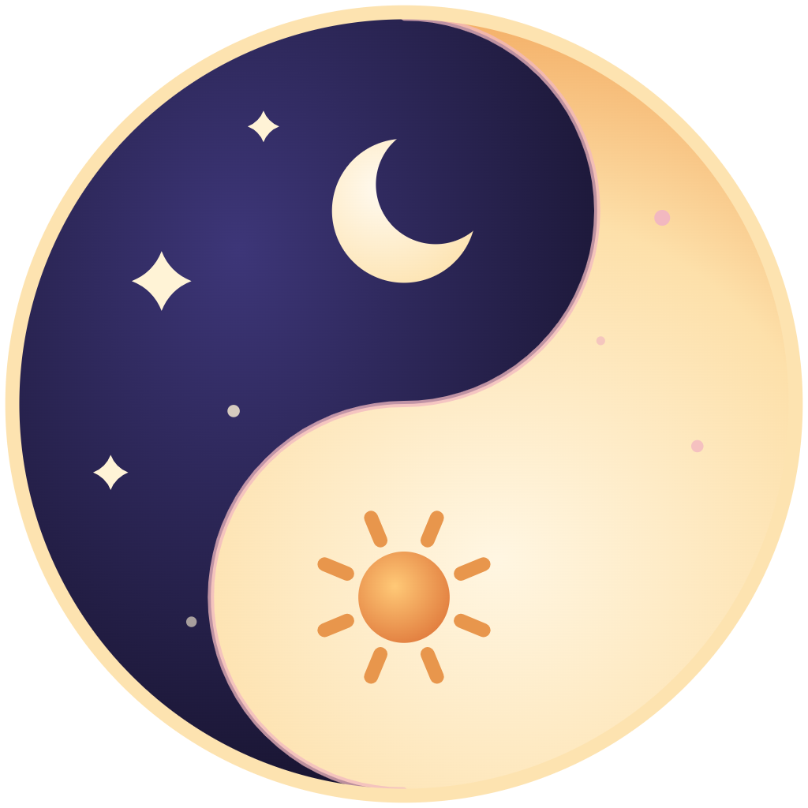

<p align="center">
  
</p>

# Portfolio


[](LICENSE)

Personal portfolio of Alessio Pianaroli, built with [Astro](https://astro.build) and published on
GitHub Pages at **https://alessiopiana54.github.io/Portfolio/**.

The whole site follows a day/night idea: the toggle in the header swaps the moon for the sun.
On the home page the moon sets behind the hills while the sun rises; on the About page a cat
hunts a moth under a street lamp (or sleeps, by day); the footer shows the real moon phase of
tonight.

## Local development

Requires Node 22 or newer.

```bash
npm install
npm run dev       # http://localhost:4321/Portfolio/
npm run build     # static site in dist/
npm run preview   # serve the built site
npm run check     # type-check .astro and .ts files
```

## Deploy

Every push to the `Website` branch runs `.github/workflows/deploy.yml`, which builds the site and publishes it.
One-time setup on GitHub: **Settings → Pages → Build and deployment → Source: GitHub Actions**.

## Where things live

```
src/
├── content/projects/   One Markdown file per project (text, cover, framing)
├── data/
│   ├── site.ts         Name, email, social links, CV, menu
│   ├── projects.ts     getProjects() / getFeaturedProjects(): projects in display order
│   ├── theme.ts        Theme colors and defaults, shared by the <head> script and the toggle
│   └── hobbies.ts      Illustrations for the About carousel
├── pages/              Routes: home, about, privacy, 404, projects
├── components/         Header, Footer, ThemeToggle, ProjectCard, Arrow, Doodle, LampCat
├── layouts/            BaseLayout (head, SEO meta, theme bootstrap)
├── styles/
│   ├── base.css        Design tokens, reset, typography
│   ├── components.css  Index of the shared component styles in styles/components/
│   └── home.css, about.css, projects.css   Page styles
├── scripts/            One module per behaviour (theme, nav, parallax, carousel, moon phase,
│   │                   footer wave, lamp cat), imported from the components' <script>
│   └── lib/motion.ts   Shared helpers: reduced motion, pause when off screen
├── utils/url.ts        url() and projectUrl(): internal links that respect the /Portfolio/ base
└── assets/             Fonts and images (optimized to WebP at build time)
public/                 Files copied as-is (favicon, og-cover, robots.txt)
```

### Add a project

1. Put the image in `src/assets/img/`.
2. Copy one of the files in `src/content/projects/`, rename it (the file name becomes the URL)
   and edit the frontmatter (the fields are described in `src/content.config.ts`). `featured: true` shows it on the home page; `order` sets the position.
3. Optional: add a `gallery` list of `{ src, alt }` images.

## Conventions

See [CONTRIBUTING.md](./CONTRIBUTING.md).
